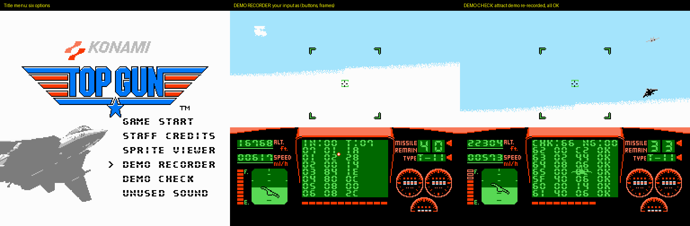
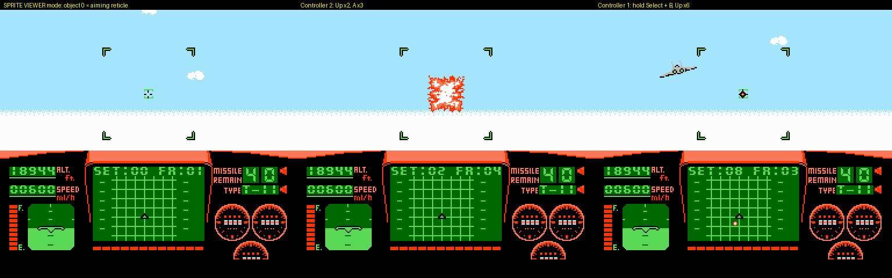
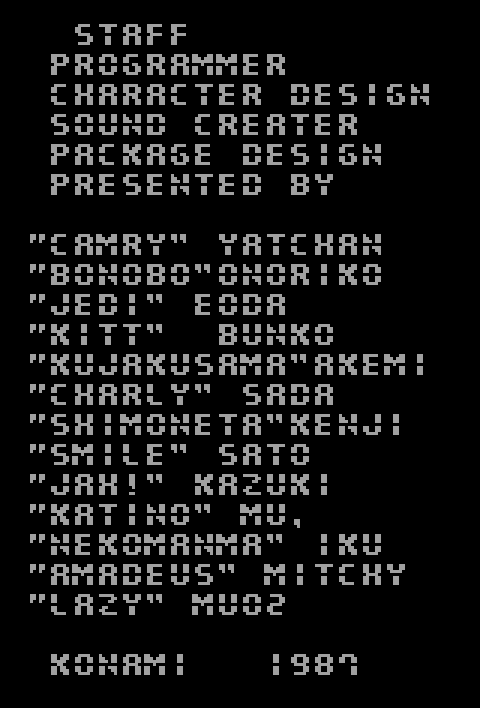
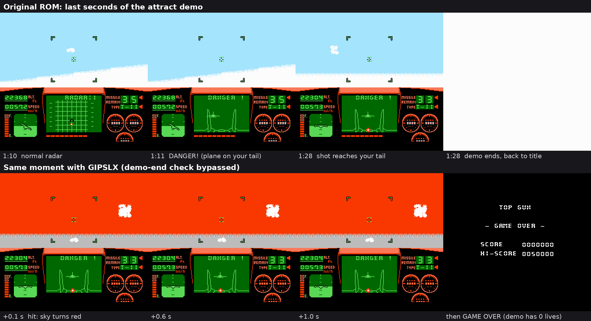

# Top Gun (NES) Extras

A patch for **Top Gun (USA) (Rev 1)** that adds a title-screen menu for content Konami left in the ROM but never uses: a sprite viewer, the recorder that made the attract demo, the staff credits and a sound nothing plays.



## What's hidden in the ROM

Everything in this list is Konami's, present in the retail cartridge and unreachable in normal play.

- **Sprite viewer** at `$E9FF`. A 36-byte routine nothing calls. Controller 2 steps object 0 through every sprite set and animation frame.
- **Attract-demo recorder** at `$CFA7`. A 38-byte routine nothing calls. It turns controller input into the (buttons, frames) pairs that make up the attract-demo table sitting right before it, and the shipped table still carries its overflow fingerprint.
- **Staff credits** in bank 6 (`$9964`–`$9AD1`). The US release never shows them.
- **Sound `$24`**, which chains into sounds `$08` and `$06`. Nothing in the game plays it. [Listen](media/unused_sound_24.ogg).
- **The end of the attract demo.** The demo plane is shot down after 4,100 of the 4,946 recorded frames, and the demo cuts to the title on that same frame, so the crash is never shown. The last 846 frames (about 14 seconds) of recorded input never play.

[docs/TECHNICAL.md](docs/TECHNICAL.md) has the disassembly, file offsets and step-by-step instructions for checking all of this yourself in a hex editor and emulator debugger.

## Konami's code vs. what this patch adds

**The patch doesn't modify any of Konami's routines or data.** It writes new code into empty space in the ROM (`$ED80`–`$F3AE`, which is unused `$FF` filler in the retail cartridge) and rewrites five instructions (13 bytes) so the game reaches that code. Everything else in the patched ROM is byte-for-byte the retail game.

Konami's two debug routines print nothing. The viewer only changes which sprite the game draws, and the recorder only leaves numbers in RAM. **All of the on-screen text readouts are added by this patch**, so you can see what the original code is doing.

| Feature | Konami's original, unchanged | Added by this patch to make it visible |
| --- | --- | --- |
| Sprite viewer | The routine at `$E9FF`: controller 2 A/B step object 0's animation frame (`$0368`), Up/Down its sprite set (`$034E`). The game's own sprite renderer draws the result. | A call to it after each controller read during flight. The `SET:xx FR:yy` readout in the radar box. The controller 1 shortcut (hold Select). |
| Demo recorder | The routine at `$CFA7`: times how long each button combination is held and leaves the result in `$2A`, `$2B` and `$2F`. | A call to it once per frame of flight. The radar-box list of finished (buttons, frames) pairs and the `IN:bb T:cc` readout. |
| Demo check | The recorder, the attract-demo playback (`$CE6F`) and the 126-entry demo table (`$CEA9`). | Running the recorder alongside the demo on its own copy of its variables, comparing each pair with the table, and the `OK`/`NG` list with the `CHK:nn NG:mm` readout. |
| Staff credits | The credits text in bank 6 (`$9964`–`$9AD1`), the font, and the Top Gun Anthem (sound `$47`). | The screen that shows and scrolls them. Quote marks and the letter O are drawn with stand-in tiles because this version's font doesn't have them. |
| Unused sound | Sound `$24` and the game's sound driver. | Triggering it from the menu, which needs the title screen's sound restriction lifted. |
| Demo ending | The DANGER! sequence, the shot and the demo-mode check (`$D21A`) that skips the crash. | Nothing. The `GIPSLX` Game Genie code below lets the crash play out. |
| Title menu | Nothing. (The title's Select button only toggles `$22`, which nothing reads.) | The whole menu. `$22` becomes the cursor. |

**The five changed call sites**, in the order the hooks run:

| Address | Original instruction | Now jumps to | Why |
| --- | --- | --- | --- |
| `$C010` | `LDA $18` / `JSR $C4BF` (main state dispatch) | new dispatcher | Adds the credits screen as a new game state and calls the recorder once per frame |
| `$C3DA` | Start pressed on the title | menu handler | Runs the chosen menu option |
| `$C3DF` | Select pressed on the title | cursor handler | Moves the menu cursor |
| `$CE69` | `JSR $CE6F` (demo playback) | playback, then the check | DEMO CHECK |
| `$EAC6` | `JSR $C36C` (read controllers) | controller read, then the viewer | SPRITE VIEWER |

In the source, [`src/topgun_extras.s`](src/topgun_extras.s) is entirely new code. Every Konami routine, table and RAM variable it uses is named in one block near the top with its original address (for example `SpriteViewer = $E9FF`), so any call to one of those names is a call into the retail game's own code.

## The menu

Press **Select** on the title screen to move the cursor and **Start** to choose.

| Option | What it does |
| --- | --- |
| GAME START | The normal game. |
| STAFF CREDITS | Scrolls the unused credits with the Top Gun Anthem. |
| SPRITE VIEWER | Starts a game with Konami's viewer active. Controller 2: A/B change the frame, Up/Down change the sprite set. On controller 1, hold Select and use the same buttons. |
| DEMO RECORDER | Starts a game with Konami's recorder running. Fly, and each button combination appears in the radar box with how long you held it. |
| DEMO CHECK | Plays the attract demo while the recorder runs alongside it. Expected result: 107 rows, all `OK`, ending on `NG:00`. |
| UNUSED SOUND | Plays sound `$24`. |

| Sprite viewer | Staff credits | How the demo really ends |
| --- | --- | --- |
|  |  |  |

In the sprite viewer, the sprites are drawn by the game itself; the `SET`/`FR` numbers are the patch's readout. The demo-ending image comes from an emulator with the `GIPSLX` code, not from the patch.

## Applying the patch

Download the patch from [Releases](../../releases) or the [`patch`](patch) folder and apply it with [Floating IPS](https://github.com/Alcaro/Flips) or [Rom Patcher JS](https://www.marcrobledo.com/RomPatcher.js/).

- **`TopGun_USA_Rev1_Extras_v1.0.bps`** (recommended) checks that you're patching the right ROM and refuses anything else.
- **`TopGun_USA_Rev1_Extras_v1.0.ips`** is the same patch for tools that only take IPS. It applies to any file without checking, so confirm your ROM first.

The patch needs **Top Gun (USA) (Rev 1)**:

| | CRC32 | SHA-1 |
| --- | --- | --- |
| With iNES header | `0C9A67A8` | `6E233846CA3BB2F50B0176CC31F5CD9667A635F5` |
| Without header | `CF6D0D7A` | `C0FCC0E837E3EC8B075685BB27908037CB57AF2A` |

The patched ROM has CRC32 `C8EECA6E`. This repository doesn't include any ROM; you need your own copy.

## Game Genie codes

These switch on Konami's routines with no patch and no on-screen readouts. They only change where the game jumps; watch the results in an emulator's RAM viewer. All are in the fixed bank, so the 6-letter forms work anywhere.

| Effect | 6-letter | 8-letter |
| --- | --- | --- |
| Sprite viewer on controller 2 | `NNIVKX` + `OVIVSX` | `NNSVKXAX` + `OVSVSXKV` |
| Demo recorder (watch `$2A`, `$2B`, `$2F`) | `NZZGLA` + `TOLGVY` + `XVGKKN` | `NZXGLESG` + `TOUGVNAA` + `XVKKKYAV` |
| Show the attract demo's crash instead of cutting to the title | `GIPSLX` | `GIOSLXGO` |

A real Game Genie takes three codes at a time, so use the viewer or the recorder, not both. [docs/TECHNICAL.md](docs/TECHNICAL.md#game-genie-codes) explains what each code changes.

## Building from source

Needs Python 3 and [cc65](https://cc65.github.io/) (`ca65` and `ld65`).

```
python src/build.py "Top Gun (USA) (Rev 1).nes"
```

This checks the ROM's SHA-1, assembles [`src/topgun_extras.s`](src/topgun_extras.s), confirms the target space is empty and each hooked call site still holds the original bytes, then writes the patched ROM, IPS and BPS to `build/`.

## Repository layout

| Path | Contents |
| --- | --- |
| `patch/` | The patch, BPS and IPS |
| `src/` | Assembly source (all new code), linker config and build script |
| `docs/TECHNICAL.md` | Full technical write-up of Konami's code and the patch |
| `media/` | Screenshots and a recording of the unused sound |

Top Gun is © 1987 Konami. This is an unofficial fan project, not affiliated with Konami.
